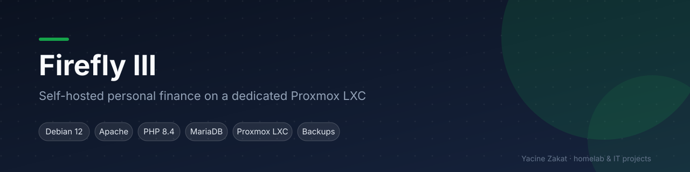
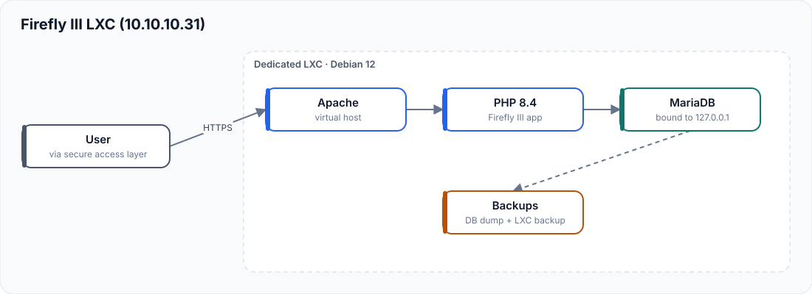

# Firefly III – Proxmox LXC Deployment

A native (non-Docker) installation of the Firefly III personal-finance manager on a dedicated Proxmox LXC: Apache, PHP 8.4 and MariaDB on Debian 12.

| | |
|---|---|
| **Status** | Lab deployment in my homelab, currently not running |
| **Stack** | Proxmox VE LXC · Debian 12 · Apache · PHP 8.4 · MariaDB 10.11 · Firefly III |
| **Related** | [Proxmox homelab](https://github.com/bugHunte3R/Proxmox) |

## Architecture

- Apache virtual host serves the Firefly III public directory
- PHP 8.4 with the extensions Firefly III requires
- MariaDB **bound to 127.0.0.1** — the database is never reachable from the network
- Backups: database dump + Proxmox LXC backup

## What I did

- Built a dedicated unprivileged LXC instead of a shared Docker host, to practise a classic LAMP-style install end to end
- Installed and configured Apache, PHP 8.4, MariaDB and Composer dependencies under `/opt/firefly`
- Hardened the database (local bind, dedicated user with least privilege) and file permissions for `www-data`
- Wrote backup, health-check and update scripts ([scripts/](scripts/))
- Documented disaster recovery: restore the LXC, then the database dump

## Fictional addressing used in this repository

| Role | Address |
|---|---|
| Firefly III LXC | `10.10.10.31` |
| Homelab network | `10.10.10.0/24` |

## Documentation

[Architecture](docs/architecture.md) · [Proxmox LXC](docs/proxmox-lxc.md) · [Debian](docs/debian.md) · [Apache](docs/apache.md) · [PHP](docs/php.md) · [MariaDB](docs/mariadb.md) · [Installation](docs/firefly-installation.md) · [Networking](docs/networking.md) · [Security](docs/security.md) · [Backups](docs/backup-strategy.md) · [Disaster recovery](docs/disaster-recovery.md) · [Maintenance](docs/maintenance.md) · [Monitoring](docs/monitoring.md) · [Troubleshooting](docs/troubleshooting.md) · [Roadmap](docs/future-improvements.md)

## Skills demonstrated

Linux administration · Apache · PHP · MariaDB · LXC · least privilege · backup and restore planning

---
**Yacine Zakat** — IT Support & Application Support Technician
