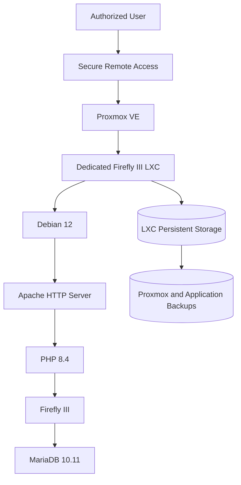
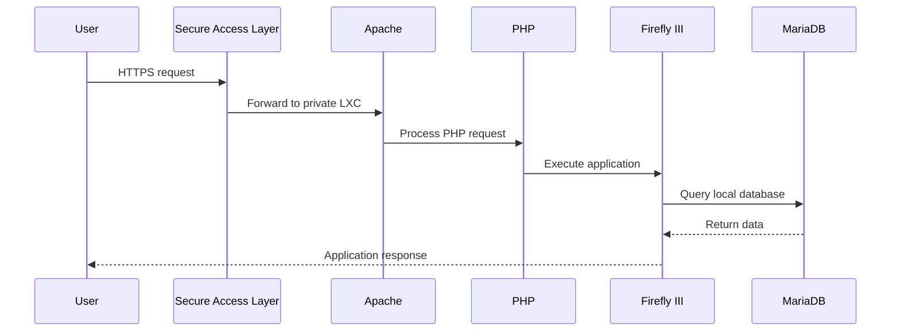

# Firefly III – Proxmox LXC Deployment


## Overview

This repository documents a sanitized **Firefly III deployment running directly inside a dedicated Proxmox LXC container**.

Unlike a Docker-based deployment, the application stack is installed natively inside the container:

- Debian GNU/Linux 12
- Apache HTTP Server
- PHP 8.4
- MariaDB 10.11
- Firefly III installed under `/opt/firefly`
- SSH administration
- Local database binding
- Secure remote publication through the homelab access layer

> This repository contains only sanitized documentation and examples. It does not contain financial records, credentials, real domains, IP addresses, database dumps, application secrets or production configuration files.

---

## Verified Architecture



---

## Verified Platform Details

| Component | Verified value |
|---|---|
| Virtualization | Proxmox VE |
| Deployment type | Dedicated LXC |
| Container role | Firefly III server |
| Operating system | Debian GNU/Linux 12 |
| Web server | Apache HTTP Server |
| PHP | PHP 8.4 |
| Database | MariaDB 10.11 |
| Application path | `/opt/firefly` |
| Database binding | Localhost only |
| Web service | HTTP on the LXC network |
| Administration | SSH |

The production VMID, IP address and domain are intentionally omitted from this public repository.

---

## Service Layout

```text
Proxmox VE
└── Dedicated Firefly III LXC
    ├── Debian 12
    ├── Apache
    ├── PHP 8.4
    ├── Firefly III
    │   └── /opt/firefly
    ├── MariaDB 10.11
    │   └── 127.0.0.1:3306
    ├── SSH
    └── Local mail service
```

---

## Network Exposure

The verified service layout uses:

- SSH for administration
- Apache for the web interface
- MariaDB bound to `127.0.0.1`
- No Docker socket
- No Docker network
- No public database listener

Example sanitized port model:

```text
22/tcp    SSH administration
80/tcp    Apache / Firefly III
3306/tcp  MariaDB on localhost only
25/tcp    Local mail service on loopback
```

Binding MariaDB to localhost reduces unnecessary network exposure.

---

## Application Request Flow



---

## Security Design

- Dedicated LXC isolation
- Database bound to localhost
- Application authentication
- No database exposed to the LAN or Internet
- SSH administration
- Secrets excluded from Git
- Database dumps excluded from Git
- Financial data excluded from screenshots
- Secure remote publication
- Separate application and infrastructure backups
- Regular Debian, PHP, Apache and MariaDB maintenance

---

## Backup Strategy

A complete recovery plan should protect:

1. MariaDB database
2. Firefly III application directory
3. Firefly III environment configuration
4. Apache virtual-host configuration
5. PHP configuration
6. Scheduled jobs
7. Proxmox LXC backup
8. Recovery documentation

A Proxmox backup protects the full container, while a database export provides application-level recovery flexibility.

---

## Monitoring and Maintenance

Useful checks:

```bash
systemctl status apache2
systemctl status mariadb
php -v
mysql --version
ss -tulpn
df -h
free -h
journalctl -u apache2 --since today
journalctl -u mariadb --since today
```

Application path verification:

```bash
find /opt/firefly -maxdepth 2 -type f | head
```

---

## Skills Demonstrated

- Proxmox VE
- Linux containers
- Debian administration
- Apache administration
- PHP application hosting
- MariaDB administration
- Local database hardening
- SSH administration
- Backup planning
- Service troubleshooting
- Secure remote access
- Technical documentation

---

## Repository Structure

```text
.
├── README.md
├── SECURITY.md
├── LICENSE
├── .gitignore
├── docs/
│   ├── architecture.md
│   ├── proxmox-lxc.md
│   ├── debian.md
│   ├── apache.md
│   ├── php.md
│   ├── mariadb.md
│   ├── firefly-installation.md
│   ├── networking.md
│   ├── security.md
│   ├── backup-strategy.md
│   ├── monitoring.md
│   ├── maintenance.md
│   ├── troubleshooting.md
│   ├── disaster-recovery.md
│   └── future-improvements.md
├── diagrams/
│   ├── architecture.md
│   ├── request-flow.md
│   ├── service-layout.md
│   └── backup-flow.md
├── examples/
│   ├── apache-vhost.example.conf
│   ├── mariadb-bind.example.cnf
│   ├── firefly-environment.example
│   ├── backup-database.example.sh
│   └── health-check.example.sh
├── scripts/
│   ├── service-status.example.sh
│   ├── backup.example.sh
│   ├── update-system.example.sh
│   └── health-check.example.sh
└── screenshots/
    └── README.md
```

---

## Privacy Notice

The following information is excluded:

- VMID
- LXC IP address
- Real domain
- Cloudflare tunnel identifiers
- Database name
- Database username
- Database password
- Application key
- Mail credentials
- Financial records
- Transactions
- Balances
- Budget information
- Database dumps
- Backup paths
- Session cookies
- Personal screenshots

---

## Author

**Yacine Zakat**

IT Support and Application Support Technician with hands-on experience in Proxmox, Debian Linux, Apache, PHP, MariaDB, application hosting, networking and secure self-hosted services.
